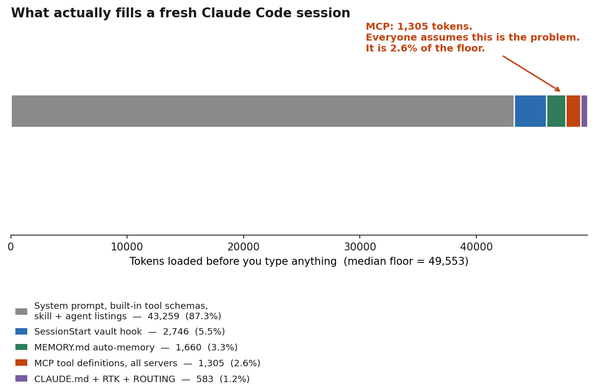
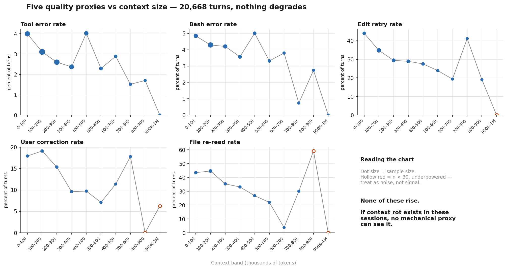
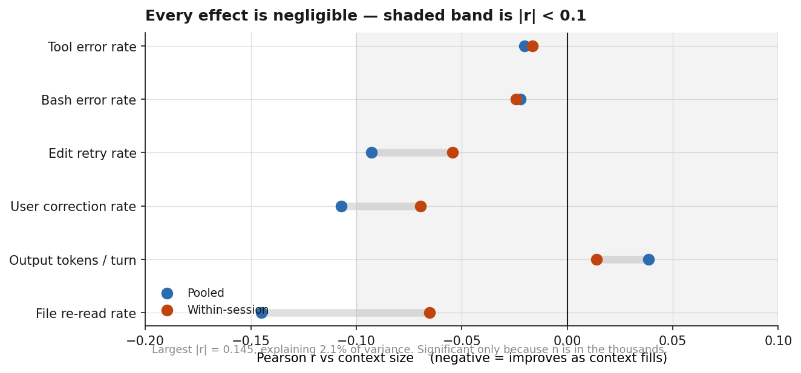
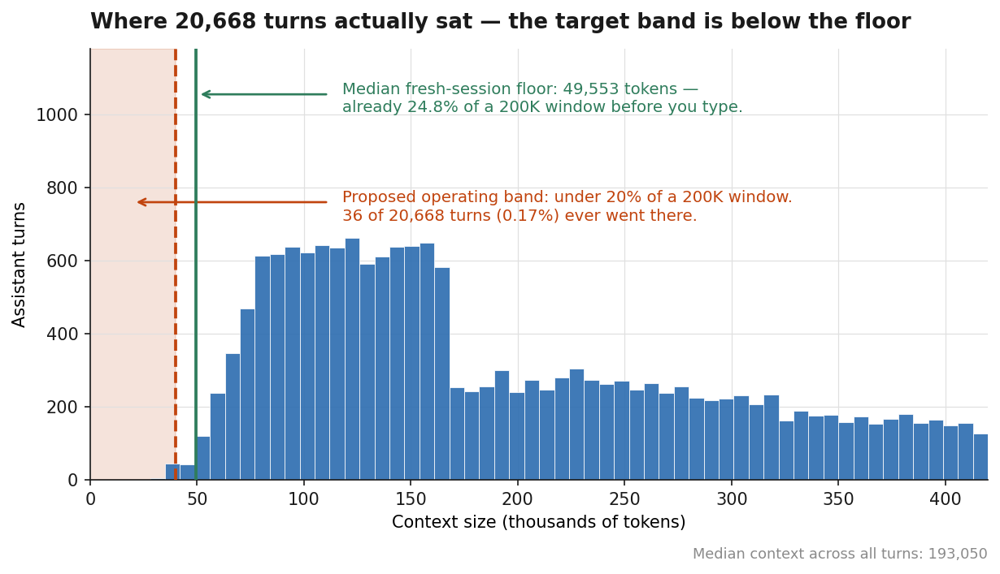
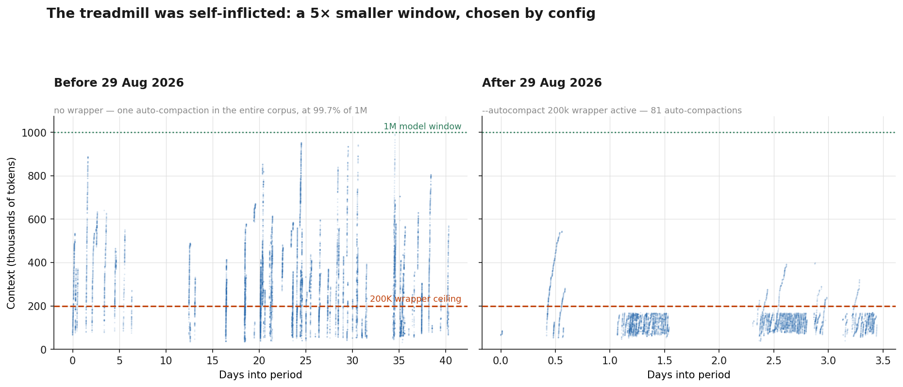
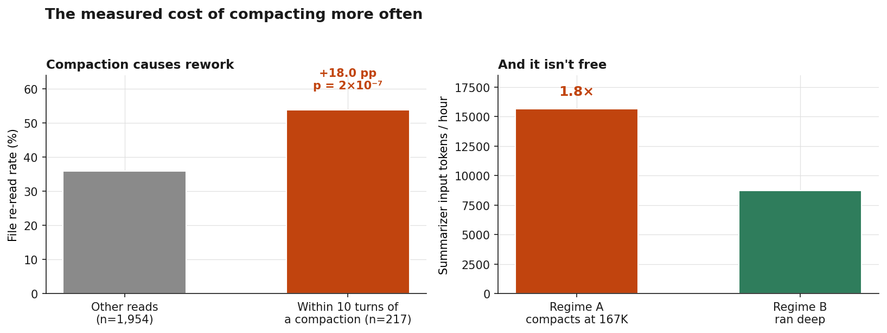

# Context Rot in Claude Code: I Measured It on 20,668 Turns and Found Nothing

**A negative result, and three things I found instead.**

Run date: 2026-09-01
Corpus: 52 main-thread session transcripts, 2026-07-19 → 2026-09-01
Volume: 20,668 assistant turns with usage data, 156 compaction events, ~790 MB of JSONL
Method: local analysis of `~/.claude/projects/**/*.jsonl`, no network calls

---

## PARAMETERS — overwrite these with your own

If you are reading this to reproduce the analysis on your own machine, these are
the only values that are specific to my setup. Everything downstream is derived.

```yaml
model: opus[1m]
model_context_window: 1000000
claude_code_version: 2.1.252
autocompact_override_env: not set
autocompact_wrapper: "--autocompact 200k"   # PowerShell function, active from 2026-08-29
mcp_servers_global: 1                        # mobbin
mcp_servers_project: 2                       # two project-scoped servers, one with autoStart false
mcp_connectors_session: 6                    # chrome, Gmail, Drive, Calendar, Superhuman, Clay
plugins_enabled: 6
local_skills: 87
local_agents: 10

measured_floor_median_tokens: 49553
measured_floor_p25: 38829
measured_floor_p75: 54987
measured_floor_min: 31688
measured_floor_max: 67614

sessions_analysed: 52
turns_analysed: 20668
compaction_events: 156        # 82 auto, 74 manual
```

Every figure below is tagged **[M] measured**, **[D] derived**, or **[A] assumed**.
Anything unavailable is written UNKNOWN.

---

## 1. The hypothesis I set out to test

Three claims, formed from a strong subjective impression that a fresh session
gives better output than a long-running one:

1. **Output quality degrades as the context window fills.**
2. **That degradation is severe enough that compacting early — around 20% of the
   window — beats letting auto-compact fire at its default.**
3. **The baseline context floor is substantial, and driven mostly by MCP tool
   definitions.**

I set my auto-compact to 200K on 2026-08-29 on the strength of that impression,
and it felt better. This report is an attempt to check whether "felt better"
survives contact with the transcripts.

**Result: limb 1 not supported. Limb 2 not supported and not executable. Limb 3
half right, with the causal half wrong.**

---

## 2. Limb 3 first, because it is the most useful finding

### MCP tool definitions cost 1,305 tokens. Not 15%. Not 10%. 2.6% of the floor.

**[M] Measured by A/B.** Two identical `claude -p` runs, same model, same prompt.
One with all MCP servers loaded, one with `--strict-mcp-config` and an empty
config file.

| Run | Total input tokens |
|---|---|
| All MCP servers | 29,292 |
| `--strict-mcp-config`, empty config | 27,987 |
| **Difference** | **1,305** |

The reason: **Claude Code defers MCP schemas by default and loads only tool
names at session start.** The full JSON schema for a tool is fetched when the
tool is actually reached for, not upfront. So the widely repeated advice to
"trim your MCP servers to save context" is optimising something that costs
about a quarter of one percent of a 1M window.

### What the floor is actually made of

A fresh session costs **49,553 tokens median** [M], across 45 sessions
(min 31,688, max 67,614).

| Component | Tokens | % of floor | Tag | Method |
|---|---|---|---|---|
| System prompt, built-in tool schemas, skill + agent listings | ~43,259 | 87.3% | **D** | by subtraction |
| SessionStart vault hook injection | ~2,746 | 5.5% | D | chars/4 on 10,982 bytes |
| MEMORY.md auto-memory | ~1,660 | 3.3% | D | chars/4 on 6,640 bytes |
| **MCP tool definitions, all servers** | **1,305** | **2.6%** | **M** | **A/B, direct** |
| CLAUDE.md + RTK.md + ROUTING.md | ~583 | 1.2% | D | chars/4 on 2,333 bytes |

**Method honesty:** chars/4 is an approximation, not a tokenizer. No Claude
tokenizer was available locally. Plausible error ±20% on the derived rows. The
MCP row is the only one measured directly.

**The 87% lump is the real target.** With 87 local SKILL.md files and 10 agent
definitions, the skill and agent listings alone are a plausible multi-thousand-token
cost that nobody talks about, because it is invisible — it never appears in a
context meter as a line item. Separating it out would need per-component A/B
runs with skills disabled. Not done here. **UNKNOWN.**



*Figure 3*

---

## 3. Limb 1: six proxies, 20,668 turns, nothing degrades

There is no ground-truth quality score in a transcript, so I built six mechanical
proxies and measured each against absolute context size.

| Proxy | What it measures |
|---|---|
| Tool error rate | fraction of `tool_result` blocks with `is_error: true` |
| Bash error rate | `is_error` on Bash results (see caveat — exit codes are not stored) |
| Edit retry rate | same `file_path` edited again within 3 turns |
| User correction rate | typed user turns matching a correction keyword list |
| Output tokens/turn | mean assistant output length |
| File re-read rate | `Read` on a path already read this session |

### Results

| Proxy | n | Pearson r | p | Partial r (controls turn index) | Within-session r | Within p |
|---|---|---|---|---|---|---|
| Tool error rate | 21,405 | −0.0202 | 3.1e−03 | −0.0207 | −0.0165 | 1.6e−02 |
| Bash error rate | 9,862 | −0.0223 | 2.7e−02 | −0.0229 | −0.0242 | 1.7e−02 |
| Edit retry rate | 5,294 | −0.0928 | 1.4e−11 | −0.0905 | −0.0545 | 8.9e−05 |
| User correction rate | 1,909 | −0.1071 | 2.8e−06 | −0.1132 | −0.0695 | 4.3e−02 |
| Output tokens/turn | 20,668 | +0.0385 | 3.0e−08 | +0.0379 | +0.0140 | 4.6e−02 |
| File re-read rate | 2,171 | −0.1451 | 1.1e−11 | −0.1402 | −0.0652 | 3.8e−03 |

**Not one proxy degrades as context fills.** Five drift slightly better, one
(output length) drifts slightly longer.

**Do not read this as "quality improves."** The largest |r| is 0.145, explaining
2.1% of variance. Every p-value is significant only because n is in the
thousands. The honest reading is **flat** — these measures are essentially
independent of context size.

The **within-session** column is the strongest test available. It demeans both
variables inside each session, removing every between-session difference: task
type, project, era, model. The result survives it.

**Two proxies are mechanically biased toward the hypothesis and still contradict
it.** Re-read rate should rise with context simply because more files have been
read by then. Edit-retry should rise because more edits have accumulated. Both
fall.



*Figure 2*



*Figure 5*

### Proxy caveats, stated plainly

- **Bash exit codes are not recorded.** [M] A Bash `toolUseResult` contains
  `stdout`, `stderr`, `interrupted`, `isImage`, `noOutputExpected` — no
  `exitCode`. Only 375 results carried a parseable `Exit code N` string. "Bash
  error rate" is the `is_error` flag, which is a weaker signal.
- **User corrections needed heavy filtering.** 2,107 raw user records reduce to
  **1,075 genuine typed turns** after removing 784 system-only records
  (`<task-notification>`, `<local-command-stdout>`, hook injections), 76 slash
  commands, and 108 pastes over 3,000 chars. **A first pass without this filter
  was wrong** and counted task notifications as user corrections. Hand
  spot-check of 20 classified turns: 0 false positives, ~4 false negatives.
  Precision high, recall roughly 20–25%.
- **Re-read rate is confounded with compaction.** The "already read" set is never
  reset at a compaction boundary, so sessions that compact often re-read more.
  This inflates the metric for exactly the strategy the hypothesis favours.
- **Model mix is a live confound.** The corpus spans opus-5 (12,609 turns,
  median context 175,501), fable-5 (5,811, median 192,901), opus-4-8 (2,079,
  median 307,692) and sonnet-5 (166, median 88,022). Models do not sit at equal
  context depths, so the pooled correlation is partly a model effect. The
  within-session test mitigates this but does not eliminate it — **16 of 45
  sessions contain more than one model.** A per-model rerun is the single most
  valuable follow-up and has not been done.

---

## 4. Limb 2: the target band is below the machine's own floor

| Measure | Value | Tag |
|---|---|---|
| Median fresh-session floor | 49,553 tokens = **24.8% of a 200K window** | M |
| Lowest context ever after any compaction | 46,470 tokens | M |
| Median context after auto-compaction | 72,297 tokens | M |
| Turns below 40,000 tokens (20% of 200K) | **36 of 20,668 = 0.17%** | M |
| Median context across all turns | 193,050 tokens | M |

**"Stay under 20% of 200K" cannot be executed.** The floor is 24.8% before a
word is typed. A policy built on that target would compact continuously and
never reach it.

Read against the **1M** window instead, 20% is 200,000 tokens — which is exactly
what the wrapper already does. It fires at 16.8% of 1M.



*Figure 1*

---

## 5. The finding I did not expect: the treadmill was self-inflicted

| Measure | Value | Tag |
|---|---|---|
| Auto-compactions in the corpus **before 2026-08-29** | **1** | M |
| That single event | 997,170 tokens = **99.7% of 1M** | M |
| Auto-compaction trigger point after the wrapper (80 of 82 events) | 165,690–182,900; median **167,879** | M |
| — as a fraction of 200,000 | 82.8%–91.5%; median **83.9%** | D |
| Median turns between compactions | 68 (min 16, max 555) | M |
| Compaction wall-clock duration | median **138 s**, max 298 s | M |

I went into this believing Claude Code auto-compacts at "about 84%" of the
window. **There is no such documented default.** [M] The official documentation
states that without an auto-compact window set, Claude Code compacts when the
conversation reaches the model's context limit.

The single pre-wrapper auto-compaction, at 99.7% of 1M, is precisely that
documented behaviour. The data and the docs agree completely.

The "84%" I believed in is real — but it is 84% **of 200,000**, a ceiling my own
PowerShell wrapper imposed. I shrank my window 5× by configuration, then
diagnosed the resulting compaction frequency as a property of the tool.



*Figure 4*

---

## 6. Compaction has a measured cost. The benefit is not measurable.

### Rework after compaction

| Measure | Value | Tag |
|---|---|---|
| File re-read rate within 10 turns after a compaction | **53.9%** (n=217) | M |
| File re-read rate for all other reads | **35.9%** (n=1,954) | M |
| Difference | **+18.0 pp**, z = 5.20, **p = 2.0 × 10⁻⁷** | D |

### Overhead by regime

| Regime | Sessions | Hours | Compactions | Per hour | Summarizer tokens/hour |
|---|---|---|---|---|---|
| **A** — auto-compacts at ~167K | 7 | 1,771.6 | 115 | 0.065 | **15,669** |
| **B** — ran deep, rarely compacted | 17 | 2,063.6 | 39 | 0.019 | 8,737 |
| **C** — manual only | 2 | 25.0 | 2 | 0.080 | 22,557 |

Regime A compacts **3.4× as often** and spends **1.8× the summarizer input
tokens per hour** as regime B. Each compaction feeds the full pre-compaction
conversation (median 165,907 tokens) back through the model to produce a
~5,000-token summary, blocks for a median of 138 seconds, and invalidates the
prompt cache.

### Quality by regime

| Regime | Turns | Tool err | Bash err | Edit retry | User corr | Re-read |
|---|---|---|---|---|---|---|
| A — compacts at 167K | 10,704 | 3.25% | 4.64% | 39.36% | 9.92% | 47.61% |
| **B — ran deep** | 9,477 | **2.70%** | **3.41%** | **24.92%** | **5.39%** | **26.68%** |
| C — manual only | 206 | 5.88% | 3.51% | n<30 | n<30 | n<30 |
| D — short, never compacted | 315 | 6.03% | 6.91% | 38.24% | n<30 | 6.25% |

**Regime B is better on every proxy — the exact opposite of the hypothesis.**

**This comparison cannot support a causal claim.** [A] Strategy was never
randomised. Regime A is almost entirely post-2026-08-29 sessions, many of them
autonomous overnight runs with heavy subagent traffic. Regime B is older
interactive work. Task mix, model, and era all move together with the strategy.
Treat this table as a description of what happened, not as evidence of what
causes what.



*Figure 6*

---

## 7. What could not be measured

1. **Actual output quality.** No ground-truth signal exists in the transcripts.
   A model that is subtly worse at reasoning — shallower analysis, weaker
   architecture calls, missed edge cases — while still emitting syntactically
   valid tool calls would be **invisible to all six proxies**. This is the
   single largest limitation and it cuts both ways: it cannot confirm the
   hypothesis and it cannot rule it out.
2. **Bash exit codes.** Not persisted in the transcript format.
3. **A controlled comparison.** Compaction strategy was never randomised.
4. **Exact token counts** for CLAUDE.md, memory, and hook output — chars/4 only.
5. **The split of the 43K remainder** between system prompt, built-in tools,
   skill listing, and agent listing. One lump, derived by subtraction.
6. **Subagent context.** 1,974 subagent transcripts excluded. Subagents run in
   their own windows, so they do not affect the main floor — but if quality
   degrades inside them, this study cannot see it.
7. **Per-model proxy breakdown.** See the model-mix caveat in section 3.
8. **Two compaction outliers.** A 570,654-token auto-compaction on 2026-08-30
   fits neither the 200K nor the 1M regime. UNKNOWN.
9. **Cache economics.** Compaction invalidates the prompt cache. Real cost, not
   quantified here.

---

## 8. Assumptions

1. Context at a turn = `input_tokens + cache_creation_input_tokens + cache_read_input_tokens`.
2. One turn = one unique `requestId`; max usage taken across records sharing one.
3. `compactMetadata.trigger` is authoritative for auto vs manual.
4. `compactMetadata.postTokens` (median 20,966) is not on the same scale as API
   usage and was not used; the first real post-compaction turn was used instead.
   The discrepancy is noted, not explained.
5. Session window = 1M if any turn exceeded 200K, else 200K.
6. Edit retry = same `file_path` within 3 turns. Legitimate multi-step edits
   count as retries; inflates the absolute rate, should not bias its slope.
7. Re-read set is not reset at compaction boundaries.
8. Correction keywords: no, nope, wrong, incorrect, actually, revert, undo,
   stop, that's not, i said, doesn't work, still broken, not what, you broke,
   you missed, you forgot, but you, why did you.
9. chars/4 token approximation for files.
10. 52 main-thread JSONL files are the complete record (`cleanupPeriodDays` = 99999).
11. Session hours = last timestamp − first, counting idle time as work. This
    inflates hours and therefore **understates** per-hour compaction overhead.

---

## 9. What I actually changed

- **Removed the `--autocompact 200k` wrapper.** It was solving a problem the
  data does not show exists, while imposing a cost the data does show.
- **Stopped trimming MCP servers for context reasons.** 1,305 tokens.
- **Left the Obsidian RAG alone.** It costs ~2.7K tokens at session start and
  its value was never in dispute — but it is not the reason my sessions behave
  differently, and it was never the floor.

## 10. What would actually settle this

The proxies cannot see reasoning quality, and reasoning quality is exactly what
I thought I noticed. That needs a deliberate experiment:

- Matched tasks, alternating `--autocompact` values across sessions
- Blind human scoring of the output
- Enough runs to detect an effect smaller than the proxies can see
- Per-model, to remove the confound in section 3

Until someone runs that, "context rot" in Claude Code remains an impression
that has not been demonstrated on mechanical measures — and my own impression
did not survive its first contact with 20,668 turns of my own data.

---

## Files

| File | Contents |
|---|---|
| `report.pdf` | this report, typeset |
| `investigation-prompt.md` | the prompt that produced this analysis, ready to run against your own transcripts |
| `data/context-timeseries.csv` | 20,702 rows, one per turn |
| `data/quality-proxies.csv` | 126 rows, both banding schemes, per-band n and power flags |
| `data/correlations.csv` | pooled + partial correlations |
| `data/within-session-correlations.csv` | fixed-effects correlations |
| `data/findings.md` | the raw findings, every figure tagged measured / derived / assumed |
| `figures/fig1`–`fig6` `.png` | figures referenced above |

**To reproduce on your own machine:** feed this file to Claude Code along with
the investigation prompt, point it at your own `~/.claude/projects/`, and
overwrite the PARAMETERS block. The analysis needs no network access.
